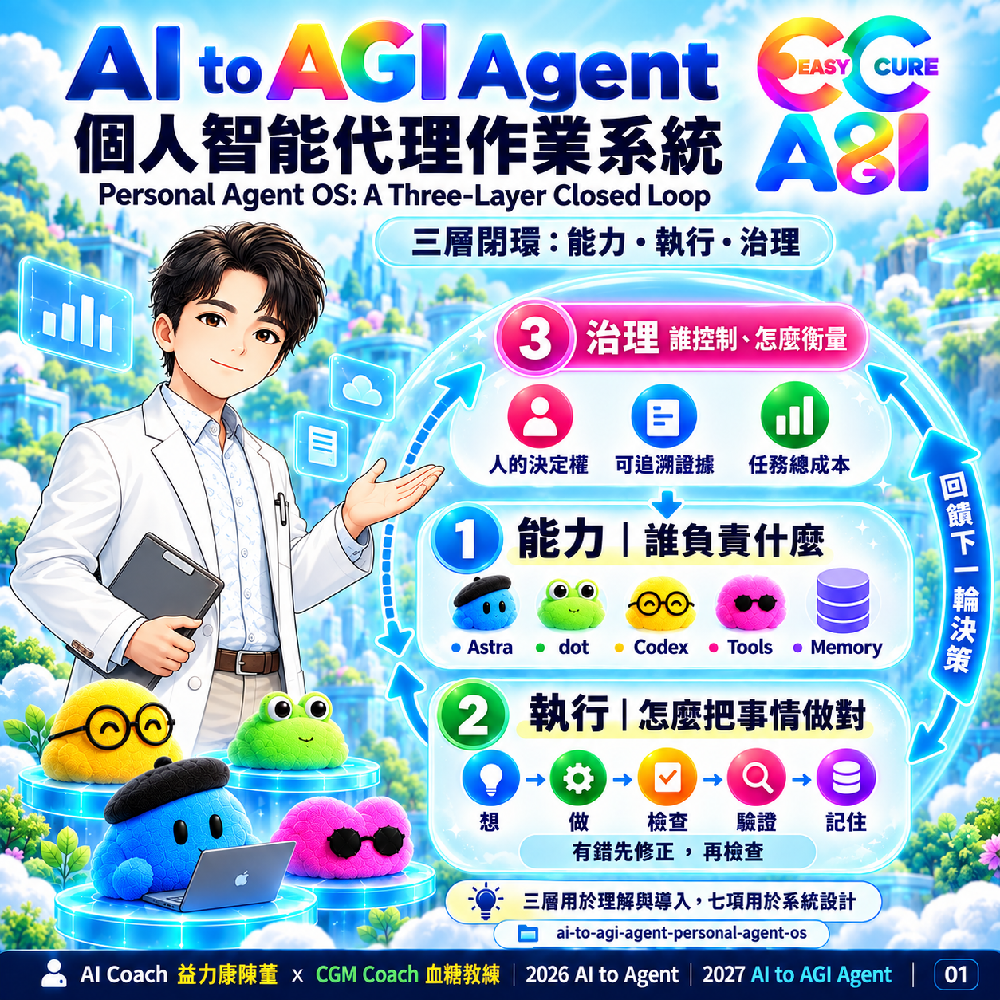

# AI to AGI Agent｜Personal Agent OS

**個人智能代理作業系統：以能力、執行、治理三層閉環，組織大腦、雲端與工作環境的協作。**

版本：0.1.0｜日期：2026-10-04｜狀態：方法論初版，保留所有權利

## 為什麼需要

將 AI 建議轉為有來源、有驗收、可接續的工作成果，減少人工搬運、版本混淆與重複整理。

## 專案定位與範圍

這是方法論與教學素材套件，包含 7 張圖卡、社群文章、架構說明及模擬案例。不是已部署的作業系統、可安裝 Skill 或可執行 Agent 程式；無需安裝相依套件。

Astra、dot、Codex 是本方法論採用的角色分工。本文不保證特定產品的常駐、自動調度、本機存取或跨應用能力；實際能力由部署、工具與授權決定。「AI to AGI Agent」是系列名稱與方向，不是已達 AGI 的技術認證。

## 三層架構

| 層次 | 問題 | 內容 |
|---|---|---|
| Personal Agent OS | 誰負責什麼？ | Astra、dot、Codex、Tools、Memory |
| Agent Execution Loop | 怎麼把事情做對？ | Think、Act、Check、Correct、Verify、Remember |
| Governance | 誰控制、怎麼衡量？ | Human Sovereignty、Evidence、Task Economics |

治理貫穿全程。檢查通過後才進入驗證；有問題時修正後回到檢查。驗證未通過則重新規劃；超出授權或重要疑義交由人決定。

## 快速開始

1. 閱讀 [架構與決策規則](docs/architecture.md)。
2. 依頁碼瀏覽 [7 張知識圖卡](docs/card-guide.md)。
3. 複製 [任務工作表](templates/task-worksheet.md)，填入目標、資料、權限與驗收條件。
4. 參照 [行政文件模擬案例](examples/admin-document-review.md)，跑一次閉環。
5. 使用 [七項設計檢查表](docs/design-checklist.md) 與任務總成本記錄檢查結果。

輸入：目標、資料來源、現有工具、授權範圍、期限與驗收條件。輸出：成果檔案、來源與判斷紀錄、驗收結果、待確認事項及成本記錄。驗收：每項需求能對應到成果或明確的未完成原因。

## 適用場景

行政文件整理、企業內訓準備、資料彙整與跨應用工作規劃。需要已授權的工具與資料。高風險決策、權利不明的素材或無法取得的私密資料，須先解決相應權限與責任問題。

## 示範

輸入「整理教育訓練文件並找出缺件」，依工作表分工；預期產出文件索引、缺件表、版本疑義表與驗收紀錄。案例為虛構教學情境，未實際連接企業系統，不代表 ISO 合規或認證結果。

## 檔案導覽

- [社群文章](content/social-post-zh-TW.md)：原社群貼文與完整署名。
- [架構說明](docs/architecture.md)、[圖卡導讀](docs/card-guide.md)、[設計檢查](docs/design-checklist.md)。
- [任務工作表](templates/task-worksheet.md)、[模擬案例](examples/admin-document-review.md)。
- `assets/cards/`：7 張 PNG；[素材清單](assets/manifest.json) 記錄 SHA-256。
- [版本變更](CHANGELOG.md)、[貢獻規範](CONTRIBUTING.md)、[授權狀態](LICENSE)、[素材與版權](COPYRIGHT.md)。
- [GitHub 上傳說明](docs/github-publishing.md)、[發布檢查](docs/release-checklist.md)、[Release Notes](releases/v0.1.0.md)。
- `project.json`：名稱、版本、日期與品牌署名的集中資訊。

## 版本與後續方向

初版 0.1.0 適用公開教學與方法設計。未來可依真實任務證據修正範本；自動化程式、工具整合及效能評估均非本版已完成功能。

## 授權與作者

本 repo 採保留所有權利（All rights reserved），見 [LICENSE](LICENSE)，並非開源授權。法律權利人為 AI Coach 益力康陳董，品牌署名不等同法律權利歸屬。Logo、人物素材、第三方標誌與生成圖像分別見 [COPYRIGHT.md](COPYRIGHT.md)。

---

AI Coach 益力康陳董 x CGM Coach 血糖教練 | 2026 AI to Agent | 2027 AI to AGI Agent
