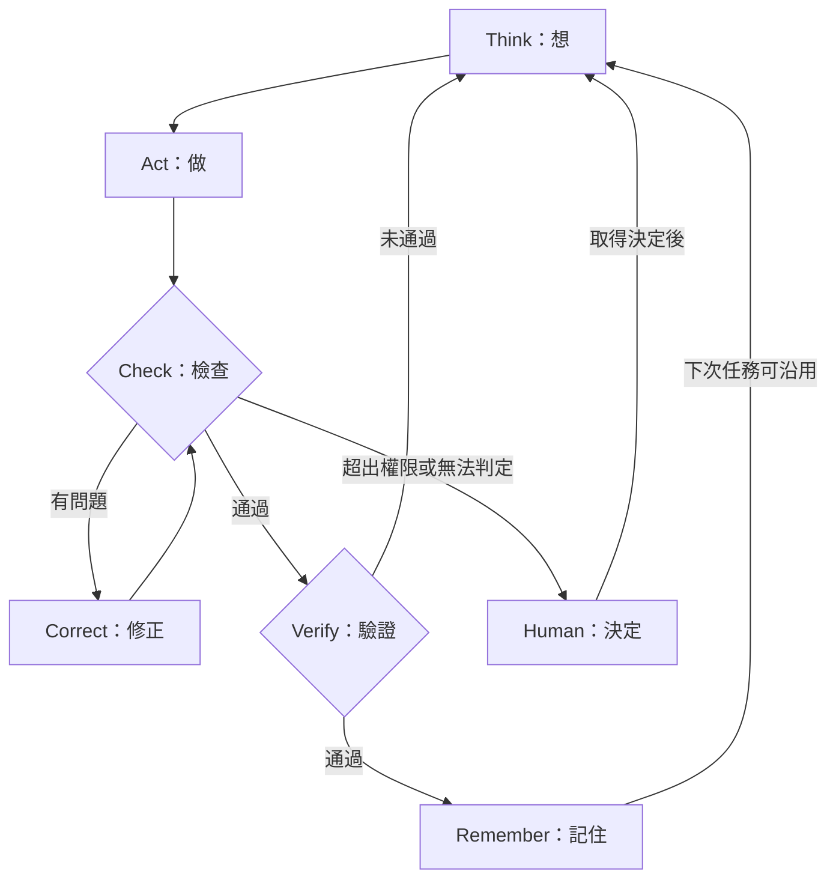

# 三層閉環：定義、流程與決策規則

## 能力層

| 元件 | 責任 | 邊界 |
|---|---|---|
| Astra | 理解、規劃、推理、調度與重新規劃 | 不取代人的授權 |
| dot | 承接雲端與跨應用的持續工作 | 依連接、排程及授權能力 |
| Codex | 深入檔案、程式與專案工作環境執行 | 不等於只能地端，也不代表已獲本機權限 |
| Tools | 實際存取與操作資料 | 工具不是獨立決策角色 |
| Memory | 保存進度與可信知識 | 必須區分驗證狀態 |

依任務選能力，不需每次全部出動。「雲地大腦」描述責任分工，不限制部署拓撲。

## 執行層

Check 檢查格式、缺漏、版本與計算；Verify 對照任務最初的驗收標準與證據。Correct 並非每次必經；修正後須重新檢查。任何階段觸及權限邊界，都應轉交人決定。

## 記憶與證據

Context Memory 保存進度、工作規則與待辦；Knowledge Memory 保存有來源、經驗證的知識。資料標記 Raw、Pending 或 Verified，並留下來源、適用範圍及驗證日期。Verified 是該次驗證的狀態，後續來源或規則變更時仍須重驗。

過程證據：操作、發現、修正原因、修正內容與重驗結果。結果證據：來源、成果位置、驗收依據與結果。不要將模型自稱完成當成驗證。

## 治理層

Human Sovereignty：人設定 Goal、Boundary、Authority。已授權的例行操作持續執行；超出邊界、關鍵來源衝突或重大未決事項應記錄並交由人處理。

Evidence：可追溯來源、行動、結果及驗證。Task Economics：在品質、時限與風險要求下，降低可靠完成任務的總成本。

TTC = 執行成本 + 驗證成本 + 修正成本 + 人工成本 + 錯誤損失。

為避免重複計算，本套件採以下歸帳約定：初次模型、工具與運算費歸執行；非人工檢查費歸驗證；非人工重試費歸修正；所有人員時間費歸人工；其餘錯誤後果歸錯誤損失。Token 數與等待時間另記，未有換算依據時不相加成貨幣總額。未發生的潛在損失另列估計，勿混同實支。

## 與 VAD／VAC 的關係

VAD（Visual Agent Design）用於呈現責任與流程；VAC（Visual Agent Card）將目標、輸入、權限、輸出與驗收寫成任務規格。本套件的工作表可作為 VAC 內容草稿，不宣稱與任何外部機器格式直接相容。

---

AI Coach 益力康陳董 x CGM Coach 血糖教練 | 2026 AI to Agent | 2027 AI to AGI Agent
