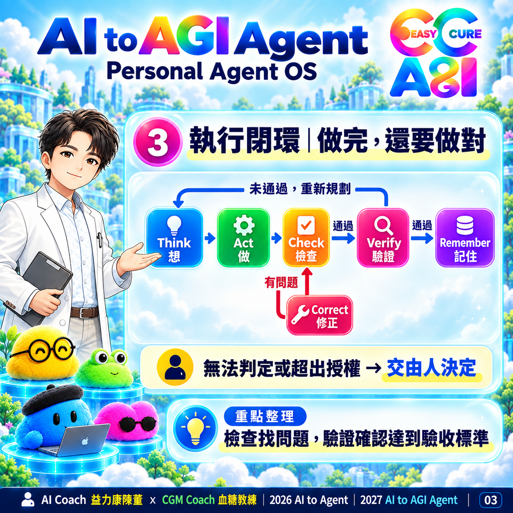
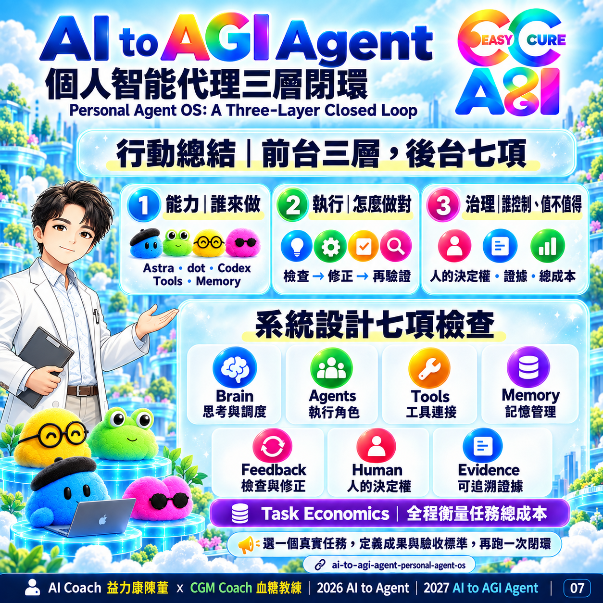

# 圖卡導讀

依 01–07 閱讀；第 07 張使用最後修正版。

## 01｜封面與三層架構總覽

## 02｜能力分工

## 03｜執行閉環

## 04｜證據與記憶

## 05｜全程治理

## 06｜任務經濟

## 07｜行動總結（修正版）

## 圖文判讀

圖卡為 AI 生成的教學視覺摘要。01 的治理置於上方，代表全程約束，不是固定執行先後；02 的萌點僅為視覺符號，Tools 仍為工具箱；03 的修正支線以文字定義「有問題 → 修正 → 再檢查」為準；07 的短句只摘要修正支線，不能取代完整閉環。正式流程與權限定義見 [架構說明](architecture.md)。

---

AI Coach 益力康陳董 x CGM Coach 血糖教練 | 2026 AI to Agent | 2027 AI to AGI Agent
